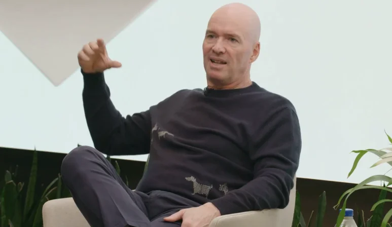

창업자는 매일 조금씩 전략을 수정하고 발전시킵니다. 머릿속에서는 그저 매일 조금씩 조정하고 있다고 생각하죠. 하지만 한 분기가 지나고 나면, 실제 전략은 처음 출발했을 때와 상당히 달라져 있는 경우가 많습니다.

​

그렇기 때문에 **회사의 스토리를 끊임없이 업데이트하는 일이 정말 중요합니다.**

회사의 이야기를 어떻게 표현하고 설명할 것인지 계속 다듬어야 한다는 뜻입니다.

저는 이 스토리를 반드시 글로 정리해 두기를 권합니다.

​

회사 구성원 모두에게 공유할 수 있고,

앞으로 채용하려는 인재들에게도 보여줄 수 있어야 합니다.

투자를 유치하려는 투자자들,

회사와 관계된 모든 이해관계자,

그리고 고객 한 사람 한 사람에게도 전달할 수 있어야 하죠.

​

그런데 제가 생각하기에 창업자들이 이 일을 잘하지 않는 데에는 한 가지 이유가 있습니다.

스토리를 만드는 일이 '일'처럼 느껴지지 않기 때문입니다.

**​**

누군가 묻습니다.

​

‘오늘은 무슨 일을 하고 있나요?’

​

‘우리 회사의 스토리를 다듬고 있습니다.’

​

이렇게 대답하면, 왠지 제대로 일하고 있다는 느낌이 들지 않죠.

​

바로 그 때문입니다. 일처럼 느껴지지 않기 때문에 사람들은 이 일을 하지 않습니다.

하지만 사실 이것이야말로 창업자가 해야 할 가장 중요한 일 중 하나입니다.”

**​**

— 벤 호로위츠(Ben Horowitz)

​

[https://x.com/a16z/status/2112321778819440880](https://x.com/a16z/status/2112321778819440880)
